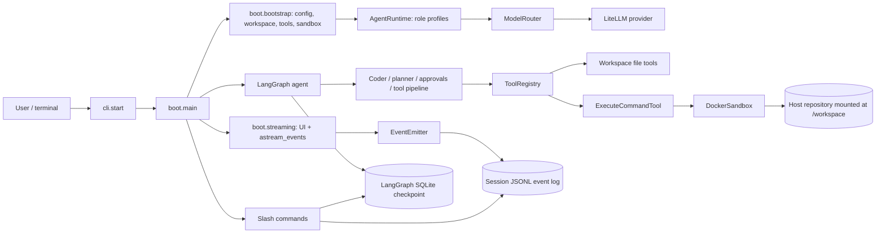
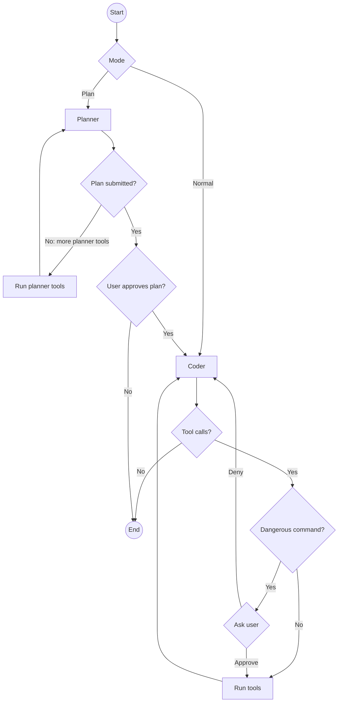
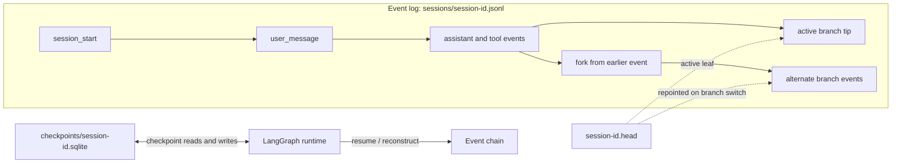

# VAMP-CLI Architecture

This document describes the implementation in `src/vamp_cli` and its runtime boundaries. It complements the user and installation guide in the [README](../README.md). The diagrams use Mermaid and render in GitHub and compatible Markdown viewers.

## System overview

VAMP-CLI is an asynchronous terminal application. The host process owns the interactive prompt, model calls, agent orchestration, event persistence, and workspace-scoped file operations. Shell commands run through a Docker container with the current workspace mounted at `/workspace`.

## Package responsibilities

| Area | Responsibility |
| --- | --- |
| `cli.py` | Console script entry point; parses list/resume/previous flags and invokes async startup. |
| `boot/` | Builds the runtime, runs the prompt loop, handles in-session commands, streams graph events, coordinates persistence and resume. |
| `agent/` | `AgentState`, graph topology, planner/coder nodes, tool approval gates, plan approval, and profile resolution. |
| `config/` | Copies the packaged default YAML to `~/.vamp/config.yaml` on first use, validates models/profiles, resolves key environment variables. |
| `llm/` | Constructs LiteLLM chat models, binds tool schemas, adds usage tracking/adapters, composes configured fallback chains. |
| `prompts/` | Loads the planner/coder prompt assets. |
| `tools/` | Defines tool contracts and dispatch; includes file/search, diagnostics, todo, plan submission, and command tools. |
| `workspace/` | Resolves paths and rejects paths outside the repository root for workspace file operations. |
| `sandbox/` | Creates and manages the Docker container and executes shell commands inside it. |
| `persistence/` | Append-only event log, stream-to-event translation, resume reconstruction, branch/fork operations, transcript output, compaction. |
| `commands/`, `ui/`, `utils/` | Prompt commands, terminal rendering, autocomplete, ignore matching, token/error helpers. |

## Startup and configuration

The installed `vamp` script is declared in `pyproject.toml` as `vamp_cli.cli:start`. `cli.start` uses the current working directory as the project workspace. It handles `--list`/`-l`, `--resume`/`-r`, and `--previous`/`-p`; otherwise it starts a new session.

`boot.main.main` calls `boot.bootstrap.create_runtime`. Bootstrap loads and validates `~/.vamp/config.yaml`, creates a `Workspace` and ignore matcher, starts a `DockerSandbox`, instantiates tool implementations, and registers them in `ToolRegistry`. `AgentRuntime` resolves coder and planner profiles from configuration. Each profile combines its configured model, permitted tool schemas, system prompt, and context window. `ModelRouter` builds the configured chat runnable and its fallback chain.

The model API key is looked up from the environment variable named by `api_key_env`. The current loader assigns the literal placeholder `EXAMPLEMODEL_API_KEY` if a configured variable is missing; it does not fail startup at that point. Provider authentication may consequently fail at invocation time.

## Agent turn and approvals

`AgentState` carries separate planner and coder message channels, current mode, task/plan/todos, iteration count, and intermediate tool-approval data. LangGraph compiles the graph with a checkpointer. The production boot path supplies `AsyncSqliteSaver`; the graph factory has an in-memory saver fallback for callers that omit one.

The planner can call `submit_plan`; after planner tool execution this routes to a plan approval interrupt. Approval allows the coder to proceed with the plan. For tool calls, `agent.nodes` classifies a narrow set of command substrings as dangerous (for example `rm`, `curl`, `wget`, `pip install`, `shutdown`, `dd`) when the tool is an execute-like tool. Safe calls are auto-approved; dangerous calls pause the graph until the user responds. Exact detection behavior is implemented in `_is_dangerous` and is not a general command sandbox policy.

The graph stops after 15 node iterations for each turn. `boot.streaming.streaming` consumes LangGraph v2 events, updates Rich terminal output, accumulates usage, and sends each event to `EventEmitter`. The emitter turns model and tool lifecycle events into session events. Tool execution is dispatched through `ToolRegistry`; file tools receive the workspace abstraction, while command execution delegates to the Docker-backed terminal.

## Workspace and sandbox boundary

File tools use `Workspace.safe_path`, which resolves candidate paths and verifies they remain under the selected repository root. Command execution runs using `docker exec ... /bin/bash -lc` with `/workspace` as the working directory. `DockerSandbox` mounts the host project at `/workspace`, constrains CPU, memory, and process count, and applies a command timeout. Network access is controlled by sandbox configuration. The sandbox is a process isolation boundary for shell execution; file tools still access the host workspace directly through the workspace path checks.

## Persistence, resume, and branching

Session data lives under `~/.vamp`:

| Artifact | Role |
| --- | --- |
| `sessions/<session-id>.jsonl` | Append-only event history. Events have UUIDs and parent UUIDs, allowing multiple branches in one log. |
| `sessions/<session-id>.head` | Sidecar pointing to the active branch leaf. |
| `checkpoints/<session-id>.sqlite` | LangGraph checkpoint state, including message objects and graph state needed to continue or resume interrupts. |
| `sessions/last/last.head` | Session ID used by `--previous`. |

`EventLog` serializes writes through an async queue. `append` waits for completion and selected event types are fsynced; `emit` enqueues without waiting. `EventEmitter` translates streamed model and tool events into JSONL events. The SQLite checkpoint is the authoritative graph state when present; the event log supplies the user-visible history, branch structure, CLI state reconstruction, and recovery path when a checkpoint is unavailable.

On resume, `persistence.loader` walks the parent chain from the active head, derives mode/session state, detects a pending interrupt, and loads the SQLite checkpoint. When the checkpoint is missing or unusable and reconstruction is enabled, it rebuilds a usable state from the event chain, with less fidelity than the checkpoint. A parked approval is presented before the graph continues.

Forking creates a new path from a selected event and seeds a new graph thread; it does not delete the old branch. Branch switching repoints the head and reloads the selected state. Compaction summarizes an earlier event range, appends a compaction event, and updates checkpoint messages while retaining original events in the JSONL history.

## Packaging and development entry points

`pyproject.toml` uses setuptools with a `src/` layout, requires Python 3.11+, packages Markdown/YAML prompt and configuration assets, and declares the `vamp` console command. Runtime dependencies include LangGraph/LangChain, LiteLLM integration, SQLite checkpoint support, Pydantic, Rich, prompt-toolkit, and YAML/path handling libraries. Pytest is configured to discover `tests/`.
